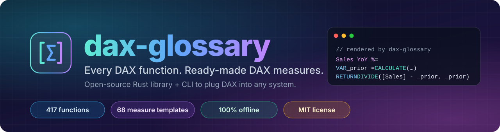
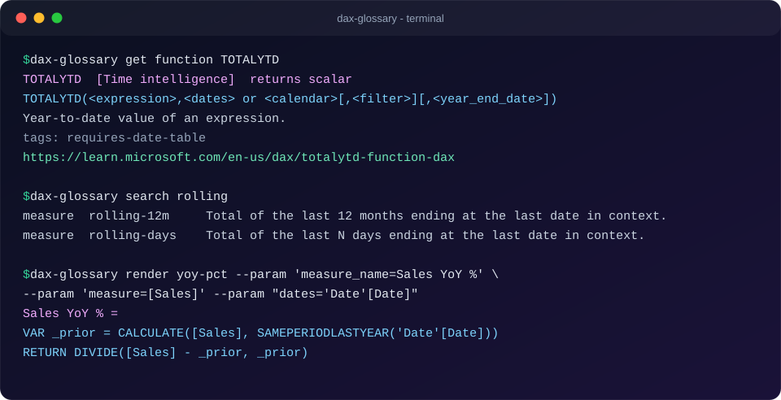
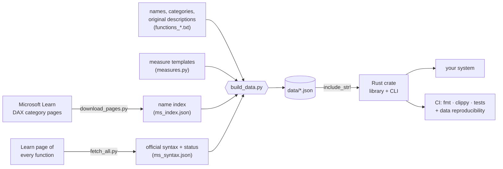

<div align="center">



<br>

[](https://github.com/BenjaminSVG/dax-glossary/actions/workflows/ci.yml)
[](LICENSE)
[](https://www.rust-lang.org)
[](#-the-function-catalog)
[](#-measure-templates)
[](Cargo.toml)
[](CONTRIBUTING.md)

**[Why](#-why-this-exists)** ·
**[See it](#-see-it-in-action)** ·
**[Quick start](#-quick-start)** ·
**[Plug it in](#-plug-it-into-your-system)** ·
**[Templates](#-measure-templates)** ·
**[Catalog](#-the-function-catalog)** ·
**[How it was built](#-how-it-was-built)** ·
**[Contribute](#-contributing)**

🇪🇸 [Leer en español](README.es.md)

</div>

---

## ✨ What is this?

**dax-glossary** is a small, dependency-light **Rust library and command-line tool** that contains, compiled right into the binary:

- 📚 **417 DAX functions** - category, official syntax, structured arguments, return kind, tags, a one-line description and a link to the Microsoft Learn page.
- 🧩 **68 measure templates** - YTD, YoY, rolling windows, running totals, % of total, Top N, ranking, Pareto, statistics, KPI colors and more. Give a template your table and column names and it **renders ready-to-paste DAX**.
- 🔌 **A stable, machine-readable surface** - a Rust API, a JSON/CSV export, and a CLI with `--json` output, so any other system can ask *"what does `TOTALYTD` take?"* or *"give me a YoY % measure for my `Sales` column"* and get a precise, validated answer.

> [!NOTE]
> No network, no database, no runtime files. The data is embedded at compile time and parsed once per process.

## 🎯 Why this exists

DAX is the formula language behind Power BI, Analysis Services and Fabric semantic models. Its knowledge lives in **web pages written for humans**. That is perfect for reading and awkward for everything else:

| If you are building... | ...you need | ...and today you get |
| --- | --- | --- |
| a BI copilot / model generator | the exact signature of every function, to prompt and to validate | scraping HTML or memorising it |
| a linter, formatter or IDE extension | names, arities, categories, volatile / iterator flags | a hand-made list that goes stale |
| a low-code or report-builder tool | *"add a YoY % measure"* without writing DAX | copy-paste from blogs |
| documentation or training material | a complete, cross-linked function index | a spreadsheet nobody maintains |

**This project opens that knowledge as data and as code**: one MIT-licensed, versioned, tested source of truth that systems can depend on, extend through pull requests, and use **directly to produce DAX measures**.

It was born inside a larger project - a Power BI → PowerPoint converter that has to *evaluate* DAX and was validated against the live Power BI engine - where it became obvious that the function knowledge and the measure patterns deserved to be a standalone, open component.

## 🎬 See it in action

<div align="center">
  
</div>

## 🚀 Quick start

**Build from source** (Rust stable):

```bash
git clone https://github.com/BenjaminSVG/dax-glossary
cd dax-glossary
cargo run --release -- stats
```

**Ask for a function:**

```bash
dax-glossary get function totalytd          # case-insensitive
dax-glossary list functions --category "Time intelligence"
dax-glossary list functions --tag iterator  # SUMX, AVERAGEX, ...
dax-glossary search "year to date"          # functions + templates, best match first
```

**Render a measure:**

```bash
dax-glossary render ytd \
  --param "measure_name=Sales YTD" \
  --param "measure=[Sales]" \
  --param "dates='Date'[Date]"
# Sales YTD = TOTALYTD([Sales], 'Date'[Date])
```

**Export everything:**

```bash
dax-glossary export functions --format json --output functions.json
dax-glossary export measures  --format csv
```

<details>
<summary><b>Full CLI reference</b></summary>

```text
list functions|measures [--category <name>] [--tag <tag>] [--json]
categories functions|measures
search <text...> [--json]
get function|measure <name|id> [--json]
render <template-id> --param key=value [--param ...] [--json]
export functions|measures --format json|csv [--output <path>]
stats
validate
```

Errors go to **stderr** with **exit code 2**; successful output is deterministic, so it is safe to diff and to parse.

</details>

## 🔌 Plug it into your system

### As a Rust library

```toml
[dependencies]
dax-glossary = { git = "https://github.com/BenjaminSVG/dax-glossary" }
```

```rust
use dax_glossary::catalog;
use std::collections::BTreeMap;

fn main() -> Result<(), Box<dyn std::error::Error>> {
    let c = catalog();                                   // parsed once per process

    let f = c.get_function("totalytd")?;                 // case-insensitive
    println!("{} -> {} ({})", f.syntax, f.returns, f.reference_url);

    for hit in c.search("rolling") { /* functions and templates, best first */ }

    let mut p = BTreeMap::new();
    p.insert("measure_name".into(), "Sales YTD".into());
    p.insert("measure".into(), "[Sales]".into());
    p.insert("dates".into(), "'Date'[Date]".into());
    println!("{}", c.render_measure("ytd", &p)?);       // Sales YTD = TOTALYTD([Sales], 'Date'[Date])
    Ok(())
}
```

### From any other language (process + JSON)

<table>
<tr><td>

**Python**

```python
import json, subprocess

def dax(template, **params):
    args = ["dax-glossary", "render", template, "--json"]
    for k, v in params.items():
        args += ["--param", f"{k}={v}"]
    return json.loads(subprocess.check_output(args))["dax"]

print(dax("pct-of-total", measure_name="% of total",
          measure="[Sales]", table="'Product'"))
```

</td><td>

**Node.js**

```js
import { execFileSync } from "node:child_process";

const fn = JSON.parse(
  execFileSync("dax-glossary", ["get", "function", "RANKX", "--json"])
);
console.log(fn.syntax, fn.args.map(a => a.name));
```

</td></tr>
</table>

### Or just read the data

The three JSON files in [`data/`](data) are the public contract - load them from any language, no Rust needed:

| file | content |
| --- | --- |
| [`data/functions.json`](data/functions.json) | the function catalog |
| [`data/measures.json`](data/measures.json) | the measure templates |
| [`data/coverage.json`](data/coverage.json) | review date, source, counts, discrepancies vs. the Learn category pages |

## 🧩 Measure templates

A template is a parameterised DAX body plus the metadata a UI or an LLM needs to fill it in:

```jsonc
{
  "id": "yoy-pct",
  "name": "YoY %",
  "kind": "measure",                       // or "calculation_item"
  "category": "Time intelligence",
  "description": "Growth against the same period last year.",
  "body": "VAR _prior = CALCULATE({{measure}}, SAMEPERIODLASTYEAR({{dates}}))\nRETURN DIVIDE({{measure}} - _prior, _prior)",
  "parameters": [
    { "name": "measure_name", "type": "name",    "description": "Name of the measure to create", "example": "YoY %" },
    { "name": "measure",      "type": "measure", "description": "Measure",                        "example": "[Sales]" },
    { "name": "dates",        "type": "column",  "description": "Date column of a marked date table", "example": "'Date'[Date]" }
  ],
  "assumptions": "Requires a date table related to the fact table and marked as the model's date table."
}
```

> [!IMPORTANT]
> **Rendering is validated, not just string-replaced.** Every parameter has a type, and the value is checked against it before it can touch the output:
>
> | type | accepts | rejects |
> | --- | --- | --- |
> | `table` | `Sales`, `'Sales Table'` | unquoted spaces, stray characters |
> | `column` | `'Sales'[Amount]` | a column without its table, unterminated quotes, `Sales[Amount]) + 1 + (` |
> | `measure` | `[Sales]` | bare names |
> | `number` | finite numbers | `5); DROP`, `NaN` |
> | `text` | anything single-line, emitted as a DAX string literal with `"` doubled | line breaks |
> | `expression` | your DAX, with balanced brackets and quotes | unbalanced input |
> | `name` | any measure name | `=` and line breaks |
>
> Missing or extra parameters are errors, and substituted values are **never re-expanded** (a value that looks like `{{measure}}` comes out verbatim).

<details>
<summary><b>📋 All 68 templates (click to expand)</b></summary>

#### Basic

| id | what it renders | parameters |
| --- | --- | --- |
| `average` | Mean of a numeric column. | `column` |
| `average-per-distinct` | A measure divided by the distinct count of a column (e.g. sales per customer). | `measure`, `column` |
| `count-nonblank` | Counts the non-blank values of a column. | `column` |
| `count-rows` | Counts the rows of a table in the current filter context. | `table` |
| `distinct-count` | Counts the different values of a column. | `column` |
| `distinct-count-noblank` | Counts the different values of a column, blank excluded. | `column` |
| `margin-pct` | Profit as a share of revenue. | `revenue`, `cost` |
| `max` | Largest value of a column. | `column` |
| `median` | Median of a numeric column. | `column` |
| `min` | Smallest value of a column. | `column` |
| `ratio` | Safe division of two measures (blank when the denominator is 0). | `numerator`, `denominator` |
| `sum` | Adds a numeric column. | `column` |
| `sumx-product` | Row-by-row product of two columns, then added. | `table`, `price`, `quantity` |
| `weighted-average` | Average of a value weighted by another column. | `table`, `value`, `weight` |

#### Calculation item

| id | what it renders | parameters |
| --- | --- | --- |
| `calc-item-mom` | Calculation item: change against the previous month for the selected measure. | `dates` |
| `calc-item-prior-year` | Calculation item: prior year of the selected measure. | `dates` |
| `calc-item-yoy-pct` | Calculation item: growth against last year for the selected measure. | `dates` |
| `calc-item-ytd` | Calculation item: year-to-date of whatever measure is selected. | `dates` |

#### Filter

| id | what it renders | parameters |
| --- | --- | --- |
| `count-with-condition` | Counts rows of a table that meet a condition. | `table`, `condition` |
| `customers-with-sales` | Distinct customers that have at least one sale in the context. | `customer`, `table`, `measure` |
| `filtered-value` | A measure restricted to one value of a column. | `measure`, `column`, `value` |
| `ignore-filter` | A measure that ignores the filters of one column. | `measure`, `column` |
| `inactive-relationship` | Uses an inactive relationship (e.g. ship date instead of order date). | `measure`, `fact_column`, `dim_column` |
| `keep-filters` | Adds a condition without overriding the visual's own filter on the column. | `measure`, `column`, `value` |
| `new-customers` | Customers whose first purchase falls in the current period. | `customer`, `order_date`, `dates_table`, `dates` |
| `selected-value` | The single selected value of a column, or a fallback text. | `column`, `fallback` |

#### Formatting

| id | what it renders | parameters |
| --- | --- | --- |
| `kpi-status-color` | Hex color for conditional formatting: green when the ratio reaches the target, red otherwise. | `measure`, `target` |
| `title-text` | Title that includes the measure value and the selected category. | `label`, `measure`, `format`, `column` |
| `trend-arrow` | Text arrow showing whether the measure is above or below a comparison measure. | `measure`, `reference` |

#### Ranking

| id | what it renders | parameters |
| --- | --- | --- |
| `bottom-n-sum` | Total of the N worst items. | `measure`, `column`, `n` |
| `rank-all` | Rank of the current item among all items (largest = 1). | `measure`, `column` |
| `rank-in-group` | Rank of an item inside its group (e.g. product inside category). | `measure`, `table`, `group` |
| `rank-selected` | Rank among the items shown in the visual. | `measure`, `column` |
| `top-n-only` | Shows the measure only for the N best items (blank for the rest); use in a visual. | `measure`, `column`, `n` |
| `top-n-share` | Share of the total held by the N best items. | `measure`, `column`, `n` |
| `top-n-sum` | Total of the N best items. | `measure`, `column`, `n` |

#### Share

| id | what it renders | parameters |
| --- | --- | --- |
| `pareto-cumulative` | Cumulative share of items ranked from largest to smallest. | `measure`, `column` |
| `pct-of-column-total` | Share of the total when one column's filter is removed. | `measure`, `column` |
| `pct-of-parent` | Share of the parent group (keeps the filter of the parent column). | `measure`, `table`, `parent` |
| `pct-of-total` | Share of the grand total ignoring all filters on a table. | `measure`, `table` |
| `pct-of-visible-total` | Share of the total of the rows shown in the visual. | `measure`, `table` |
| `share-of-selected` | Share of the sum of the currently selected values of a column. | `measure`, `column` |

#### Statistics

| id | what it renders | parameters |
| --- | --- | --- |
| `coefficient-variation` | Standard deviation divided by the mean. | `column` |
| `percentile` | Inclusive percentile of a column. | `column`, `k` |
| `stdev` | Sample standard deviation of a column. | `column` |
| `z-score` | Standard score of a measure across the items of a column. | `measure`, `column` |

#### Time intelligence

| id | what it renders | parameters |
| --- | --- | --- |
| `closing-balance-month` | Balance at the last date of the month. | `measure`, `dates` |
| `closing-balance-year` | Balance at the last date of the year. | `measure`, `dates` |
| `days-since-last` | Days between today and the last date with a transaction. | `fact_dates` |
| `last-date-with-data` | Latest date on which a fact column has a value. | `dates`, `date_table`, `fact` |
| `last-n-days` | Total of the N days before today. | `measure`, `dates`, `days` |
| `mom-pct` | Growth against the previous month. | `measure`, `dates` |
| `moving-average-months` | Average monthly value over the last N months. | `measure`, `dates`, `months` |
| `mtd` | Month-to-date total of a measure. | `measure`, `dates` |
| `opening-balance-month` | Balance at the day before the month starts. | `measure`, `dates` |
| `prior-month` | The measure for the previous month. | `measure`, `dates` |
| `prior-quarter` | The measure for the previous quarter. | `measure`, `dates` |
| `prior-year` | The measure for the same period one year earlier. | `measure`, `dates` |
| `qoq-pct` | Growth against the previous quarter. | `measure`, `dates` |
| `qtd` | Quarter-to-date total of a measure. | `measure`, `dates` |
| `rolling-12m` | Total of the last 12 months ending at the last date in context. | `measure`, `dates` |
| `rolling-days` | Total of the last N days ending at the last date in context. | `measure`, `dates`, `days` |
| `running-total` | Cumulative total from the first date up to the last date in context. | `measure`, `dates`, `date_table` |
| `yoy-abs` | Difference against the same period last year. | `measure`, `dates` |
| `yoy-pct` | Growth against the same period last year. | `measure`, `dates` |
| `ytd` | Year-to-date total of a measure. | `measure`, `dates` |
| `ytd-fiscal` | Year-to-date with a fiscal year end (text like "6/30"). | `measure`, `dates`, `year_end` |
| `ytd-vs-prior-ytd` | Year-to-date growth against the previous year-to-date. | `measure`, `dates` |


</details>

## 📚 The function catalog

| Category | Functions | | Examples |
| --- | ---: | --- | --- |
| 💰 Financial | **51** | `████████████████████` | PMT, XIRR, XNPV |
| 📐 Math and trig | **50** | `████████████████████` | DIVIDE, ROUND |
| ⏱️ Time intelligence | **45** | `██████████████████` | TOTALYTD, DATEADD |
| 📊 Statistical | **40** | `████████████████` | RANKX, MEDIAN, STDEV.S |
| 🧠 Information | **37** | `███████████████` | ISBLANK, HASONEVALUE |
| 🗃️ Table manipulation | **32** | `█████████████` | SUMMARIZECOLUMNS, TOPN |
| 📅 Date and time | **24** | `█████████` | DATEDIFF, EOMONTH |
| 🔤 Text | **24** | `█████████` | FORMAT, CONCATENATEX |
| ➕ Aggregation | **22** | `█████████` | SUM, AVERAGEX, DISTINCTCOUNT |
| ℹ️ INFO | **20** | `████████` | INFO.TABLES, INFO.MEASURES |
| 🔍 Filter | **19** | `███████` | CALCULATE, FILTER, ALL |
| 🔀 Logical | **15** | `██████` | IF, SWITCH, COALESCE |
| 🎛️ Visual calculations | **14** | `█████` | RUNNINGSUM, MOVINGAVERAGE |
| 🪟 Window | **8** | `███` | INDEX, OFFSET, WINDOW |
| 🌳 Parent and child | **5** | `██` | PATH, PATHITEM |
| 🧮 Calculation group | **4** | `██` | SELECTEDMEASURE |
| 🧰 Other | **4** | `██` | BLANK, ERROR |
| 🔗 Relationship | **3** | `█` | RELATED, USERELATIONSHIP |

Every entry looks like this:

```jsonc
{
  "name": "SUM",
  "category": "Aggregation",
  "tags": [],
  "syntax": "SUM(<column>)",
  "args": [ { "name": "column", "required": true, "variadic": false } ],
  "returns": "number",
  "description": "Adds all numbers in a column.",
  "reference_url": "https://learn.microsoft.com/en-us/dax/sum-function-dax",
  "syntax_source": "microsoft-learn"
}
```

**Tags** make the catalog useful for tooling: `iterator` · `volatile` · `calculate-modifier` · `table-returning` · `requires-date-table` · `window` · `visual-calculations` · `calculation-group` · `financial`.

## 🛠 How it was built



1. **Collect.** The list of function names comes from the Microsoft Learn DAX *category pages* (aggregation, date and time, filter, ... ). That is the authoritative inventory.
2. **Verify every page.** A script fetched the Learn page of **every one of the 417 catalog entries**: each returned HTTP 200, and the first syntax block became the entry's `syntax`. Where the official block was malformed (unbalanced brackets) the catalog falls back to a corrected form and says so in `syntax_source`.
3. **Describe in original words.** Descriptions are short summaries written for this project, not copied text. The full specification stays one click away in `reference_url`.
4. **Parse the syntax.** Arguments are extracted from the syntax (`<name>`, optional `[...]`, variadic `...`) into structured `args`.
5. **Author the templates.** Each template carries typed parameters, a worked example and the model assumptions it relies on.
6. **Embed and expose.** The generated JSON is compiled into the binary with `include_str!`; the library offers lookup, search, filtering, export and rendering; the CLI wraps the same API.

### 🧪 How it is verified

| check | what it guarantees |
| --- | --- |
| **Coverage test** | no function listed on the Learn category pages is missing from the catalog (`coverage.json` records the review date and the exceptions) |
| **Integrity test** | unique names and ids, known categories, non-empty descriptions, Learn links, balanced and consistent syntax, args present in the syntax |
| **Template test** | every template's example renders with no leftover placeholders; declared and used parameters match |
| **Rendering tests** | aggregation, YTD, YoY, Top N, quoting, injection attempts, missing / extra parameters, no re-expansion |
| **CLI tests** | every command, JSON / CSV output, exit codes |
| **CI** | `cargo fmt --check`, `cargo clippy -D warnings`, `cargo test`, and a job that regenerates the data and fails if it differs from what is committed |

**27 tests** plus a doctest, all passing.

### 🧭 Design decisions

- **Embedded JSON, two dependencies.** Only `serde` / `serde_json`. Nothing to install at runtime, nothing to fetch, nothing to go stale in production.
- **Data is the contract, Rust is a convenience.** The JSON files are plain and documented; the crate just adds fast lookup, search and safe rendering.
- **Templates are typed.** A DAX measure built from user input is code; treating parameters as typed values (and rejecting everything else) keeps the output predictable.
- **Honest provenance.** Each entry says where its syntax came from, and the coverage report says what is *not* on the category pages instead of hiding it.

## 🗂 Project layout

```text
dax-glossary/
├── src/            lib.rs · catalog.rs (types, lookup, search, validate, export) · render.rs · main.rs (CLI)
├── data/           functions.json · measures.json · coverage.json        <- generated, committed
├── gen/            Python generators (names, syntax fetch, templates, build_data.py)
├── tests/          catalog_integrity · rendering · cli
├── assets/         banner.svg · terminal.svg
└── .github/        CI workflow
```

## 🧑‍💻 Development

```bash
cargo test                                # everything
cargo clippy --all-targets -- -D warnings
cargo fmt --check
```

<details>
<summary><b>No C toolchain on your machine (e.g. Windows without Visual Studio Build Tools)?</b></summary>

Run the same commands in a container:

```bash
docker run --rm -v "$PWD:/work" -v dax-cargo:/usr/local/cargo/registry \
  -e CARGO_TARGET_DIR=/tmp/target -w /work rust:1 cargo test
```

</details>

<details>
<summary><b>Regenerate or extend the data</b></summary>

```bash
python gen/download_pages.py      # Learn category pages -> gen/cache/ (git-ignored)
python gen/ms_index.py            # names listed on those pages -> gen/ms_index.json
python gen/compare.py             # what the catalog is missing / has extra
# add missing lines to gen/functions_*.txt   (NAME | category | syntax | returns | description)
python gen/fetch_all.py           # official syntax + page status -> gen/ms_syntax.json
python gen/build_data.py          # writes data/*.json and data/coverage.json
```

To add a **measure template**, append an `M(...)` call to [`gen/measures.py`](gen/measures.py) and run `build_data.py`; the integrity tests refuse templates with undeclared placeholders, unused parameters or examples that do not render.

</details>

## ⚠️ Limits

> [!WARNING]
> - Descriptions are short original summaries. For the full, authoritative specification follow each entry's `reference_url`.
> - `syntax` is the first syntax block of the Learn page; other forms live in `syntax_alternatives`.
> - A rendered measure is only as correct as **your model**: table, column and relationship names are yours, and time-intelligence templates need a proper date table (each template lists its `assumptions`).
> - The catalog is a snapshot (`review_date` in `data/coverage.json`). DAX keeps growing; run the refresh steps above to catch up.

## 🗺 Roadmap

- [ ] Publish to crates.io
- [ ] Per-argument types and descriptions (not only names and optionality)
- [ ] Worked examples per function
- [ ] More templates: cohorts, retention, forecast vs. actual, what-if
- [ ] Prebuilt binaries in GitHub Releases
- [ ] Localised descriptions (PRs welcome)

## 🤝 Contributing

Contributions are very welcome - new templates, corrected syntax, better descriptions, translations, bindings for other languages. Read [CONTRIBUTING.md](CONTRIBUTING.md); the short version: edit the sources in `gen/`, run `build_data.py`, run the tests, open a PR.

## 📄 License, attribution and trademarks

- Code and original text: **[MIT](LICENSE)**.
- Function names, argument lists and syntax forms describe the public interface of the DAX language and were taken from the [Microsoft Learn DAX reference](https://learn.microsoft.com/en-us/dax/dax-function-reference); each entry links to its source page. Descriptions are written for this project.
- *Microsoft*, *Power BI*, *Azure Analysis Services* and *Fabric* are trademarks of the Microsoft group of companies. This project is **independent and not affiliated with, endorsed by, or sponsored by Microsoft**.
- If you are a rights holder and want something changed, open an issue.

<div align="center">

<sub>Made so that DAX knowledge is a dependency you can `cargo add`, not a web page you have to scrape.</sub>

</div>
