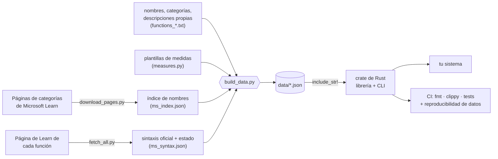

<div align="center">


<br>

[](https://github.com/BenjaminSVG/dax-glossary/actions/workflows/ci.yml)
[](LICENSE)
[](https://www.rust-lang.org)
[](#-el-cat%C3%A1logo-de-funciones)
[](#-plantillas-de-medidas)
[](Cargo.toml)
[](CONTRIBUTING.md)

**[Por qué](#-por-qué-existe)** ·
**[Demo](#-míralo-en-acción)** ·
**[Inicio rápido](#-inicio-rápido)** ·
**[Conéctalo](#-conéctalo-a-tu-sistema)** ·
**[Plantillas](#-plantillas-de-medidas)** ·
**[Catálogo](#-el-catálogo-de-funciones)** ·
**[Cómo se hizo](#-cómo-se-hizo)** ·
**[Contribuir](#-contribuir)**

🇬🇧 [Read in English](README.md)

</div>

---

## ✨ ¿Qué es?

**dax-glossary** es una **librería y herramienta de línea de comandos en Rust**, pequeña y con casi cero dependencias, que lleva compilado dentro del binario:

- 📚 **{{FUNCTIONS}} funciones DAX** - categoría, sintaxis oficial, argumentos estructurados, tipo de retorno, etiquetas, una descripción corta y el enlace a la página de Microsoft Learn.
- 🧩 **{{TEMPLATES}} plantillas de medidas** - YTD, YoY, ventanas móviles, acumulados, % del total, Top N, ranking, Pareto, estadística, colores de KPI y más. Dale a una plantilla los nombres de tu tabla y tus columnas y **genera DAX listo para pegar**.
- 🔌 **Una superficie estable y legible por máquinas** - API de Rust, exportación JSON/CSV y CLI con salida `--json`, para que cualquier otro sistema pregunte *«¿qué argumentos recibe `TOTALYTD`?»* o *«dame una medida de crecimiento interanual para mi columna `Sales`»* y reciba una respuesta precisa y validada.

> [!NOTE]
> Sin red, sin base de datos, sin archivos en ejecución. Los datos van incrustados en tiempo de compilación y se leen una sola vez por proceso.

## 🎯 Por qué existe

DAX es el lenguaje de fórmulas de Power BI, Analysis Services y los modelos semánticos de Fabric. Su conocimiento vive en **páginas web escritas para personas**. Eso es perfecto para leer y incómodo para todo lo demás:

| Si estás construyendo... | ...necesitas... | ...y hoy tienes... |
| --- | --- | --- |
| un copiloto de BI / generador de modelos | la firma exacta de cada función, para el prompt y para validar | hacer scraping de HTML o memorizar |
| un linter, formateador o extensión de IDE | nombres, aridad, categorías, banderas volátil / iterador | una lista a mano que se desactualiza |
| una herramienta low-code o de informes | *«agrega una medida de crecimiento interanual»* sin escribir DAX | copiar y pegar de blogs |
| documentación o material de formación | un índice completo y enlazado de funciones | una hoja de cálculo que nadie mantiene |

**Este proyecto abre ese conocimiento como datos y como código**: una única fuente de verdad con licencia MIT, versionada y probada, de la que los sistemas pueden depender, que se amplía con pull requests y que sirve **para producir medidas DAX directamente**.

Nació dentro de un proyecto mayor - un conversor de Power BI a PowerPoint que tiene que *evaluar* DAX y fue validado contra el motor real de Power BI - donde quedó claro que el conocimiento de las funciones y los patrones de medidas merecían ser un componente abierto e independiente.

## 🎬 Míralo en acción

<div align="center">
  
</div>

## 🚀 Inicio rápido

**Compilar desde el código** (Rust estable):

```bash
git clone https://github.com/BenjaminSVG/dax-glossary
cd dax-glossary
cargo run --release -- stats
```

**Consultar una función:**

```bash
dax-glossary get function totalytd          # sin distinguir mayúsculas
dax-glossary list functions --category "Time intelligence"
dax-glossary list functions --tag iterator  # SUMX, AVERAGEX, ...
dax-glossary search "year to date"          # funciones + plantillas, mejor coincidencia primero
```

**Generar una medida:**

```bash
dax-glossary render ytd \
  --param "measure_name=Sales YTD" \
  --param "measure=[Sales]" \
  --param "dates='Date'[Date]"
# Sales YTD = TOTALYTD([Sales], 'Date'[Date])
```

**Exportar todo:**

```bash
dax-glossary export functions --format json --output functions.json
dax-glossary export measures  --format csv
```

<details>
<summary><b>Referencia completa de la CLI</b></summary>

```text
list functions|measures [--category <nombre>] [--tag <etiqueta>] [--json]
categories functions|measures
search <texto...> [--json]
get function|measure <nombre|id> [--json]
render <id-plantilla> --param clave=valor [--param ...] [--json]
export functions|measures --format json|csv [--output <ruta>]
stats
validate
```

Los errores salen por **stderr** con **código de salida 2**; la salida correcta es determinista, así que se puede comparar con diff y parsear sin miedo.

</details>

## 🔌 Conéctalo a tu sistema

### Como librería de Rust

```toml
[dependencies]
dax-glossary = { git = "https://github.com/BenjaminSVG/dax-glossary" }
```

```rust
use dax_glossary::catalog;
use std::collections::BTreeMap;

fn main() -> Result<(), Box<dyn std::error::Error>> {
    let c = catalog();                                   // se procesa una vez por proceso

    let f = c.get_function("totalytd")?;                 // sin distinguir mayúsculas
    println!("{} -> {} ({})", f.syntax, f.returns, f.reference_url);

    for hit in c.search("rolling") { /* funciones y plantillas, mejores primero */ }

    let mut p = BTreeMap::new();
    p.insert("measure_name".into(), "Sales YTD".into());
    p.insert("measure".into(), "[Sales]".into());
    p.insert("dates".into(), "'Date'[Date]".into());
    println!("{}", c.render_measure("ytd", &p)?);       // Sales YTD = TOTALYTD([Sales], 'Date'[Date])
    Ok(())
}
```

### Desde cualquier otro lenguaje (proceso + JSON)

<table>
<tr><td>

**Python**

```python
import json, subprocess

def dax(template, **params):
    args = ["dax-glossary", "render", template, "--json"]
    for k, v in params.items():
        args += ["--param", f"{k}={v}"]
    return json.loads(subprocess.check_output(args))["dax"]

print(dax("pct-of-total", measure_name="% del total",
          measure="[Sales]", table="'Product'"))
```

</td><td>

**Node.js**

```js
import { execFileSync } from "node:child_process";

const fn = JSON.parse(
  execFileSync("dax-glossary", ["get", "function", "RANKX", "--json"])
);
console.log(fn.syntax, fn.args.map(a => a.name));
```

</td></tr>
</table>

### O simplemente lee los datos

Los tres JSON de [`data/`](data) son el contrato público: cárgalos desde cualquier lenguaje, sin necesitar Rust.

| archivo | contenido |
| --- | --- |
| [`data/functions.json`](data/functions.json) | el catálogo de funciones |
| [`data/measures.json`](data/measures.json) | las plantillas de medidas |
| [`data/coverage.json`](data/coverage.json) | fecha de revisión, fuente, conteos y diferencias frente a las páginas de categorías de Learn |

## 🧩 Plantillas de medidas

Una plantilla es un cuerpo DAX parametrizado más los metadatos que necesita una interfaz o un LLM para rellenarla:

```jsonc
{
  "id": "yoy-pct",
  "name": "YoY %",
  "kind": "measure",                       // o "calculation_item"
  "category": "Time intelligence",
  "description": "Growth against the same period last year.",
  "body": "VAR _prior = CALCULATE({{measure}}, SAMEPERIODLASTYEAR({{dates}}))\nRETURN DIVIDE({{measure}} - _prior, _prior)",
  "parameters": [
    { "name": "measure_name", "type": "name",    "description": "Name of the measure to create", "example": "YoY %" },
    { "name": "measure",      "type": "measure", "description": "Measure",                        "example": "[Sales]" },
    { "name": "dates",        "type": "column",  "description": "Date column of a marked date table", "example": "'Date'[Date]" }
  ],
  "assumptions": "Requires a date table related to the fact table and marked as the model's date table."
}
```

> [!IMPORTANT]
> **El render se valida, no es un simple reemplazo de texto.** Cada parámetro tiene un tipo y su valor se comprueba antes de tocar la salida:
>
> | tipo | acepta | rechaza |
> | --- | --- | --- |
> | `table` | `Sales`, `'Sales Table'` | espacios sin comillas, caracteres sueltos |
> | `column` | `'Sales'[Amount]` | una columna sin su tabla, comillas sin cerrar, `Sales[Amount]) + 1 + (` |
> | `measure` | `[Sales]` | nombres sin corchetes |
> | `number` | números finitos | `5); DROP`, `NaN` |
> | `text` | cualquier texto de una línea, emitido como literal DAX con `"` duplicadas | saltos de línea |
> | `expression` | tu DAX, con paréntesis y comillas balanceados | entradas desbalanceadas |
> | `name` | cualquier nombre de medida | `=` y saltos de línea |
>
> Faltar parámetros o sobrar alguno es un error, y los valores sustituidos **nunca se vuelven a expandir** (un valor que parezca `{{measure}}` sale tal cual).

<details>
<summary><b>📋 Las {{TEMPLATES}} plantillas (clic para desplegar)</b></summary>

{{TEMPLATE_CATALOG}}

</details>

## 📚 El catálogo de funciones

{{CATEGORY_TABLE}}

Cada entrada tiene esta forma:

```jsonc
{
  "name": "SUM",
  "category": "Aggregation",
  "tags": [],
  "syntax": "SUM(<column>)",
  "args": [ { "name": "column", "required": true, "variadic": false } ],
  "returns": "number",
  "description": "Adds all numbers in a column.",
  "reference_url": "https://learn.microsoft.com/en-us/dax/sum-function-dax",
  "syntax_source": "microsoft-learn"
}
```

**Etiquetas** que hacen útil el catálogo para herramientas: `iterator` · `volatile` · `calculate-modifier` · `table-returning` · `requires-date-table` · `window` · `visual-calculations` · `calculation-group` · `financial`.

## 🛠 Cómo se hizo



1. **Recopilar.** La lista de nombres de funciones sale de las *páginas de categorías* de DAX en Microsoft Learn (agregación, fecha y hora, filtro, ...). Es el inventario autoritativo.
2. **Verificar cada página.** Un script descargó la página de Learn de **cada una de las {{FUNCTIONS}} entradas**: todas respondieron HTTP 200 y el primer bloque de sintaxis pasó a ser la `syntax` de la entrada. Donde el bloque oficial estaba mal formado (paréntesis sin cerrar), el catálogo usa una forma corregida y lo indica en `syntax_source`.
3. **Describir con palabras propias.** Las descripciones son resúmenes cortos escritos para este proyecto, no texto copiado. La especificación completa queda a un clic en `reference_url`.
4. **Analizar la sintaxis.** Los argumentos se extraen de la sintaxis (`<nombre>`, opcional `[...]`, variádico `...`) a `args` estructurados.
5. **Redactar las plantillas.** Cada plantilla lleva parámetros tipados, un ejemplo resuelto y los supuestos del modelo en los que se apoya.
6. **Incrustar y exponer.** El JSON generado se compila dentro del binario con `include_str!`; la librería ofrece búsqueda, filtrado, exportación y render; la CLI envuelve la misma API.

### 🧪 Cómo se verifica

| comprobación | qué garantiza |
| --- | --- |
| **Prueba de cobertura** | ninguna función listada en las páginas de categorías de Learn falta en el catálogo (`coverage.json` registra la fecha de revisión y las excepciones) |
| **Prueba de integridad** | nombres e ids únicos, categorías conocidas, descripciones no vacías, enlaces a Learn, sintaxis balanceada y coherente, argumentos presentes en la sintaxis |
| **Prueba de plantillas** | el ejemplo de cada plantilla se genera sin marcadores sobrantes; parámetros declarados y usados coinciden |
| **Pruebas de render** | agregación, YTD, YoY, Top N, comillas, intentos de inyección, parámetros que faltan o sobran, sin re-expansión |
| **Pruebas de CLI** | todos los comandos, salida JSON / CSV, códigos de salida |
| **CI** | `cargo fmt --check`, `cargo clippy -D warnings`, `cargo test` y un trabajo que regenera los datos y falla si difieren de los confirmados |

**{{TESTS}} pruebas** más un doctest, todas en verde.

### 🧭 Decisiones de diseño

- **JSON incrustado, dos dependencias.** Solo `serde` / `serde_json`. Nada que instalar, nada que descargar, nada que se quede viejo en producción.
- **Los datos son el contrato; Rust es una comodidad.** Los JSON son simples y documentados; el crate solo añade búsqueda rápida y render seguro.
- **Las plantillas están tipadas.** Una medida DAX construida con datos de usuario es código; tratar los parámetros como valores tipados (y rechazar el resto) mantiene la salida predecible.
- **Procedencia honesta.** Cada entrada dice de dónde salió su sintaxis, y el informe de cobertura dice qué *no* está en las páginas de categorías en vez de esconderlo.

## 🗂 Estructura del proyecto

```text
dax-glossary/
├── src/            lib.rs · catalog.rs (tipos, búsqueda, validación, exportación) · render.rs · main.rs (CLI)
├── data/           functions.json · measures.json · coverage.json        <- generados, versionados
├── gen/            generadores en Python (nombres, descarga de sintaxis, plantillas, build_data.py)
├── tests/          catalog_integrity · rendering · cli
├── assets/         banner.svg · terminal.svg
└── .github/        flujo de CI
```

## 🧑‍💻 Desarrollo

```bash
cargo test                                # todo
cargo clippy --all-targets -- -D warnings
cargo fmt --check
```

<details>
<summary><b>¿Sin toolchain de C en tu máquina (p. ej. Windows sin Visual Studio Build Tools)?</b></summary>

Ejecuta los mismos comandos en un contenedor:

```bash
docker run --rm -v "$PWD:/work" -v dax-cargo:/usr/local/cargo/registry \
  -e CARGO_TARGET_DIR=/tmp/target -w /work rust:1 cargo test
```

</details>

<details>
<summary><b>Regenerar o ampliar los datos</b></summary>

```bash
python gen/download_pages.py      # páginas de categorías de Learn -> gen/cache/ (ignorado por git)
python gen/ms_index.py            # nombres listados en esas páginas -> gen/ms_index.json
python gen/compare.py             # qué le falta / le sobra al catálogo
# añade las líneas que falten a gen/functions_*.txt   (NOMBRE | categoría | sintaxis | retorno | descripción)
python gen/fetch_all.py           # sintaxis oficial + estado de la página -> gen/ms_syntax.json
python gen/build_data.py          # escribe data/*.json y data/coverage.json
```

Para añadir una **plantilla de medida**, agrega una llamada `M(...)` a [`gen/measures.py`](gen/measures.py) y ejecuta `build_data.py`; las pruebas de integridad rechazan plantillas con marcadores sin declarar, parámetros sin usar o ejemplos que no se generan.

</details>

## ⚠️ Límites

> [!WARNING]
> - Las descripciones son resúmenes cortos propios. Para la especificación completa y autoritativa sigue el `reference_url` de cada entrada.
> - `syntax` es el primer bloque de sintaxis de la página de Learn; otras formas están en `syntax_alternatives`.
> - Una medida generada es tan correcta como **tu modelo**: los nombres de tablas, columnas y relaciones son tuyos, y las plantillas de inteligencia de tiempo necesitan una tabla de fechas adecuada (cada plantilla indica sus `assumptions`).
> - El catálogo es una instantánea (`review_date` en `data/coverage.json`). DAX sigue creciendo; ejecuta los pasos de regeneración para ponerte al día.

## 🗺 Hoja de ruta

- [ ] Publicar en crates.io
- [ ] Tipos y descripciones por argumento (no solo nombre y opcionalidad)
- [ ] Ejemplos resueltos por función
- [ ] Más plantillas: cohortes, retención, previsión vs. real, what-if
- [ ] Binarios precompilados en GitHub Releases
- [ ] Descripciones localizadas (se aceptan PRs)

## 🤝 Contribuir

Las contribuciones son muy bienvenidas: plantillas nuevas, sintaxis corregida, mejores descripciones, traducciones, bindings para otros lenguajes. Lee [CONTRIBUTING.md](CONTRIBUTING.md); en corto: edita las fuentes de `gen/`, ejecuta `build_data.py`, corre las pruebas y abre un PR.

## 📄 Licencia, atribución y marcas

- Código y texto original: **[MIT](LICENSE)**.
- Los nombres de funciones, listas de argumentos y formas de sintaxis describen la interfaz pública del lenguaje DAX y se tomaron de la [referencia DAX de Microsoft Learn](https://learn.microsoft.com/en-us/dax/dax-function-reference); cada entrada enlaza a su página de origen. Las descripciones están escritas para este proyecto.
- *Microsoft*, *Power BI*, *Azure Analysis Services* y *Fabric* son marcas del grupo de empresas de Microsoft. Este proyecto es **independiente y no está afiliado, respaldado ni patrocinado por Microsoft**.
- Si eres titular de derechos y quieres que se cambie algo, abre un issue.

<div align="center">

<sub>Hecho para que el conocimiento de DAX sea una dependencia que puedes añadir con `cargo add`, no una página web que tienes que raspar.</sub>

</div>
